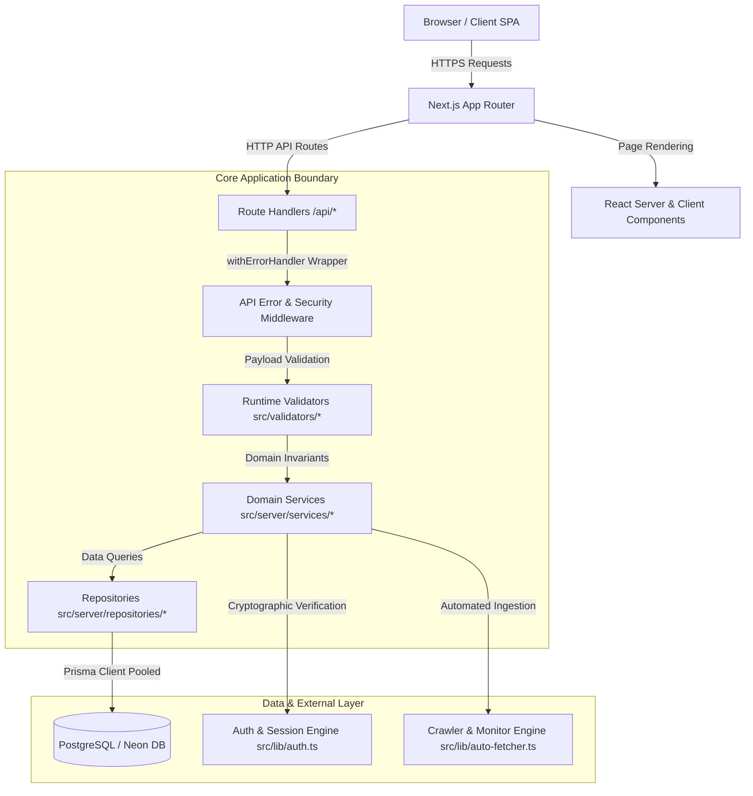

# System Architecture — BharatExam Tracker

## 1. Overview and Core Philosophy

BharatExam Tracker is an enterprise-grade recruitment discovery, application stage-tracking, and official advisory aggregation platform tailored for Indian public sector examinations (Union, State, Banking, Defence, Railway, and Technical commissions).

The application is architected around **strict official data integrity**:
- Direct official portal linking (`.gov.in`, `nic.in`, `ibps.in`) with non-repudiation.
- Dynamic $N$-stage application progression (arbitrary stages: CBT 1 $\rightarrow$ CBT 2 $\rightarrow$ Skill Test $\rightarrow$ DV $\rightarrow$ Medical).
- Zero fabricated data or artificial rankings.
- Tiered separation of concerns: Presentation (React Server/Client Components) $\rightarrow$ Application Services $\rightarrow$ Persistence Repositories $\rightarrow$ PostgreSQL via Prisma.

---

## 2. Layered Architecture & Module Responsibilities

### Module Responsibilities

| Layer / Directory | Primary Responsibility | Rules & Invariants |
| :--- | :--- | :--- |
| `src/app/` | Next.js App Router routing, layout nesting, pages, error boundaries (`error.tsx`), and API route handlers (`/api/*`). | No direct database queries in client components. Handlers must be wrapped in `withErrorHandler`. |
| `src/components/` | Modular presentation components partitioned by domain (`admin`, `checklists`, `discovery`, `notes`, `vault`, `layout`). | Focused on rendering, micro-interactions, and accessibility. Business logic delegates to custom hooks. |
| `src/hooks/` | Client-side reactive lifecycle, network state, optimistic updates, and `AbortController` cancellation. | Encapsulates API requests; raw `fetch` calls are banned in favor of `apiClient`. |
| `src/server/services/` | Business rules, eligibility calculations, workflow state transitions, and coordination across multiple repositories. | Framework-agnostic TypeScript classes and modules. Pure business rules. |
| `src/server/repositories/`| Encapsulates Prisma queries, database operations, filtering logic, and pagination. | Only layer with direct access to `prisma` database client. |
| `src/server/utils/` | Shared backend infrastructure: `api-handler.ts` (operational errors, safe 500 logging, secret redaction). | Never exposes stack traces or internal configuration to clients. |
| `src/validators/` | Runtime input validation boundary schemas (e.g., `shortlist.validator.ts`). | Runs before service logic; throws typed `ValidationError` on bad input. |
| `src/lib/` | Domain engines (`eligibility-engine.ts`, `profile-matcher.ts`, `stage-engine.ts`, `auth.ts`, `api-client.ts`, `logger.ts`). | Shared utilities for both server and client where designated. |
| `src/config/` | Centralized environment validation (`env.ts`). | Enforces secret isolation; throws fatal error early if required server variables are missing. |
| `tests/` | Automated test suites (unit, integration, and rule validation) powered by Vitest. | Fast, isolated execution without live network dependencies. |

---

## 3. Application Data Flow

### A. Data Fetching & Search Flow
1. User interacts with discovery filters on `/discover` (e.g., degree, state, salary, fresher-only).
2. The `useRecruitments` hook executes `api.recruitments.getAll(filters, { signal })`.
3. If user updates filters while a request is in-flight, previous requests are aborted via `AbortController`, preventing out-of-order state corruption.
4. Route handler `/api/recruitments` passes query params to `RecruitmentService.getRecruitments()`.
5. `RecruitmentRepository.findManyWithFilters()` compiles structured Prisma `where` clauses and returns sanitized models.
6. Client updates local server state without unnecessary page re-renders.

### B. Optimistic State Mutation (Shortlist Toggle)
1. User clicks the bookmark icon on an exam card.
2. `useShortlist` immediately updates local UI state (optimistic update) and adds the item to an in-flight guard set to block duplicate clicks.
3. `api.shortlist.toggle(recruitmentId)` transmits request to `/api/shortlist`.
4. Route handler invokes `validateToggleShortlistInput(body)`:
   - If invalid: rejects with `ValidationError` (400).
   - If valid: executes `ShortlistService.toggleShortlist(userId, recruitmentId)`.
5. If the network or server fails, `useShortlist` automatically rolls back the local state to the previous snapshot and displays a non-intrusive alert.

---

## 4. Business Logic / UI Separation

To maintain high maintainability and testability:
- **Presentation Components**: Receive data via props and trigger actions via callbacks or hooks. They contain zero database logic and zero raw HTTP requests.
- **Custom React Hooks**: Manage client lifecycle, loading indicators, optimistic transitions, and debouncing.
- **Server Services**: Host domain algorithms (e.g., eligibility matching against notification age cutoffs, category relaxations). These functions are unit-tested without mocking the React DOM.
- **Data Access Repositories**: Isolate ORM queries. If the underlying database schema changes, only the repository layer requires adjustment.

---

## 5. Security & Isolation Boundaries

1. **Authentication & Session Cookies**:
   - Authentication tokens are signed JWTs stored in `httpOnly`, `SameSite=Lax`, `Secure` (in production) cookies (`bharat_exam_session`).
   - JavaScript execution in the browser cannot read the session cookie, eliminating XSS token theft vectors.
2. **Server-Only Secrets**:
   - `JWT_SECRET`, `DATABASE_URL`, and `CRON_SECRET` are never prefixed with `NEXT_PUBLIC_`.
   - `src/config/env.ts` enforces that server-only variables are never bundled into client chunks.
3. **Internal Error Redaction**:
   - All uncaught route exceptions are trapped by `withErrorHandler`.
   - Clients receive an opaque UUID error digest and a generic message. Internal stack traces, database schema names, and connection details are logged to secure server stdout and never returned in HTTP responses.
